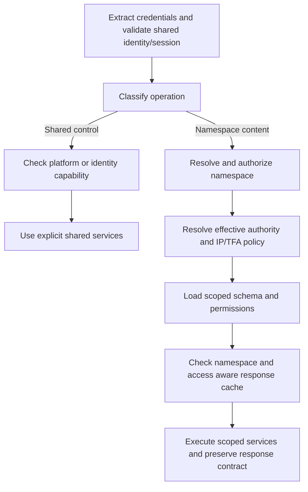

# T4 — API architecture notes

Reviewed 2026-10-14. Status: **Architecture notes documented; implementation and runtime verification pending**.

## 1. Scope and evidence

Virtual namespaces change how the fork selects data, metadata and effective authority inside one instance. Existing API callers retain their contracts. This document describes the required architecture and the gaps in current Foundation work; it does not establish deployed isolation.

Read with:

- [Endpoint inventory](endpoint-inventory.md): existing contracts at `1c2506b2464bb3384fc37ce344dee33a71863559`.
- [Traffic analysis](traffic-analysis.md): sanitized Infrastructure-only priorities for 30 September–14 October 2026.
- [Backward compatibility plan](back-compat-plan.md): Infrastructure preservation policy and T5 validation requirements.
- [Architecture](architecture.md) and [agent brief](agent-brief.md): control/namespace planes, reference areas and prototype boundaries, subject to the decisions below.
- [Frontend API handoff](RFD/frontend/frontend-api-handoff.md), [shared decision register](RFD/frontend/frontend-implementation-plan.md#4-backend-handoff-and-unresolved-decisions) and [global administration design](RFD/frontend/global-admin-design.md): integration requirements and ownership.

Current source was inspected on `hackathon` at `13106c95b72734073e972f3a12d951a4e2dea2f1`. It includes namespace groundwork added after T1. The intended base is `v12.0.7`; that tag is unavailable locally, and package versions do not prove equivalence to the deployed image. Deployment patches/configuration, enabled extensions and live schemas remain unverified.

The prototype keeps existing Infrastructure collections together in their legacy context. Prepare separate namespace fixtures rather than move production collections. The seven reference areas, including empty ones, remain initial provisioning inputs: `AAA`, `Platform_Plus`, `Scraper`, `SRE`, `Test`, `Tracking`, `Translations`. Dynamic creation/readiness belongs to D06. Other CMS deployments and future production migration are outside the Infrastructure compatibility evidence.

Traffic ranks validation work. Anonymous Caller A–D labels do not identify users or tokens, and request/response bodies were unavailable. Resolve defaults from authenticated account ownership. Unmeasured endpoints remain supported.

## 2. Confirmed architecture decisions

These rules resolve conflicting inputs for T4:

| Concern | Rule used by T4 | Superseded statement in the original inputs |
| --- | --- | --- |
| Global Admin | Authority inherits from main-namespace admin access. It permits entry into a child without membership and remains independent of a lower child role. A child admin role cannot grant platform authority. | `users.is_global_admin` in the architecture, agent brief and B5 task description. |
| Namespace-admin user visibility | List local members; use a limited, authorized shared-user lookup to add existing accounts. Global directory/profile/account administration requires platform authority. | Unrestricted shared-user reads in the agent brief and B6 task description. |

The original documents/task descriptions retain those older statements; use the confirmed rules above for this handoff. The exact main-namespace identity and effective-access representation remain Foundation/shared-contract details under D04. Do not substitute the main role ID for a missing child role or manufacture a persisted child membership.

Membership remains `(user, namespace) → one local role`, unique per user/namespace. Removing a membership preserves the account and assignments elsewhere. Namespace admins manage local schema, flows, roles and existing-user assignments. Global Admin content requests still address one namespace at a time; cross-namespace directory/provisioning operations use separate platform capabilities.

## 3. What must remain compatible

The [T3 preservation table](back-compat-plan.md#2-what-must-remain-compatible) and T1 controller contracts are the detailed baseline.

| Surface | Boundary |
| --- | --- |
| Items and deployment URLs | Keep `/items/<collection>`, collection casing, keys, methods and the configured API base URL. `/v9/infrastructure/` identifies the deployment, not a virtual namespace. Existing callers need no new selector or payload field. |
| Queries and responses | Preserve projections/relations, filters, deep selections, sorting, pagination, aggregates, singleton/batch/SEARCH behavior, envelopes and cardinality. Preserve existing status/error codes and successful empty bodies, including write/read-back 204. |
| Authentication | Retain static tokens, valid unscoped JWTs, sessions, JSON/cookie modes, providers, SSO/TFA, redirects and refresh rotation. `expires` remains a duration in milliseconds. Namespace introduction requires no forced rotation or logout. |
| Credentials and assets | Preserve query-token support and Bearer precedence. Legacy asset GET cookie precedence differs from HEAD; D07 must establish safe scoped assets across tabs while preserving the legacy baseline. Retain bytes, transformations, Range/HEAD/content headers and upload response variants. |
| GraphQL and tools | Preserve both GraphQL scopes, transport/method rules, permission-filtered schemas and execution errors/partial data at HTTP 200. Retain enabled metadata, Files, Settings, translation, flow/webhook, Insights and import/export capabilities and their specialized responses. Export submission is not job completion. |
| Fork/deployment integration | Preserve existing package, CLI, SDK, `@directus/`, `directus_*` and `DIRECTUS_*` identifiers. Keep deployment-patched error/config/OAuth/logger file locations compatible with the deploy build. Effective deployed overrides still need verification. |

Additive namespace discovery, effective-access, token mint/refresh and membership APIs are permitted. Verified token claims, optional selectors, internal routing, cache keys and execution context may change. Existing `users.role` requests must not silently become membership writes. New directory/onboarding functionality belongs to D14.

## 4. Data placement and schema routing

| Resources | Physical placement | Required access boundary |
| --- | --- | --- |
| Users, memberships, registry, sessions, migrations | Shared control plane | Shared identity/session and explicit registry/account operations. Current membership lookup names `directus_user_namespaces`; registry/provisioning interfaces remain D06. |
| Roles and permissions | Shared tables with `namespace` | Filter reads and validate writes by the active namespace, including direct IDs and nested relations. Membership roles must belong to the selected namespace. Platform authority is checked separately. |
| Activity and revisions | Shared tables with `namespace` | Stamp originating namespace; filter reads and resolve revert against that namespace's collection/item. Colliding names/IDs must not identify a peer record. |
| Collections, fields, relations, domain tables | Selected namespace's Postgres schema | Introspection, query execution, relations, transactions and DDL use the same namespace. Reject cross-namespace domain relations. |
| Flows, operations, webhooks, presets, dashboards, panels, notifications, shares | Selected namespace's Postgres schema | Definitions, IDs, execution and related records remain local. Share authentication also touches shared sessions under D08. |
| Files and folders | Shared storage/tables | Shared physical storage does not grant cross-namespace visibility. Ownership, any namespace column, ACLs, direct asset access and generated exports require D07. |
| Settings | Optional shared arrangement, finalized last | D09 defines readable/editable fields, translation and branding boundaries. Shared-instance writes require platform authority; Settings functionality remains supported. |

"Each namespace has its own system tables" means copies of its **local** system resources. Provisioning must not shadow shared users, sessions, roles or other control tables with child copies. Shared tables require an explicit shared database handle or qualified routing; their location must not depend on a missing child table.

Introspection must expose the selected namespace's domain tables plus deliberately exposed shared system resources, with the code-defined system metadata merged as T1 describes. It must not enumerate legacy or peer domain tables. Local schema/admin authority cannot alter shared physical tables or shared system definitions.

Validate selection through the registry/readiness and authorization checks before mapping it to a database schema. A header or payload is not a trusted schema identifier. Use stable scoped handles; never mutate a shared pool's search path for each request. Propagate the selected handle into transactions and nested services. Namespace-local lookup must fail when its table is absent; no collection-based search or fallback into `public` domain tables is allowed.

## 5. Request, switch and authorization lifecycle

Target lifecycle for authenticated API work; root/static/ping retain their T1 behavior:

Keep existing request parsing, validation and query sanitization semantics. For namespace content:

1. A **verified access-token `namespace` claim** is authoritative. Accept a matching `x-namespace`; reject a conflict before protected access or side effects.
2. Without a claim, an authenticated caller may select an authorized namespace through the header. Otherwise use a deterministic owner default that preserves legacy access. A configured instance default is sufficient only when that mapping/access is demonstrated.
3. Unknown, inaccessible or unready explicit targets fail closed. Missing defaults must not trigger an arbitrary content fallback. Namespace denial is distinguishable from expired/invalid session; exact new errors remain D02/D03.
4. Resolve membership and role ownership, effective admin/app flags and applicable IP/TFA policy consistently. The main-derived global entitlement and local role are separate inputs. Permission resolution retains ordinary field/row policies, dynamic variables and minimum app grants.
5. Establish schema/ACL and current authorization before serving cached protected results. Cache hits cannot bypass entitlement checks or revive revoked access.

Shared login, identity/bootstrap, available-namespace discovery and token issuance must remain reachable without membership in a default namespace. Classify service operations as well as routes: `/graphql/system` contains shared auth operations and scoped resource operations, so its path alone cannot select one plane. Anonymous/public/share resolution requires D08; skipping authenticated membership middleware is not a complete public isolation policy.

Switching validates the target and mints a fresh scoped access token while retaining the shared session. Minting must support the agreed client commit/reconciliation behavior, including a lost response. Refresh revalidates effective access and preserves the requesting tab's namespace; the shared refresh session must not store one globally active namespace for all tabs. D03 owns concurrent rotation and revocation semantics. Auth extension filters and custom claims must pass the same namespace/authority validation.

In a child, role/user lifecycle operations use membership semantics explicitly. Deleting a child role must not suspend a shared account or alter another namespace's assignment. D05 defines affected local membership handling and last-local-admin/self-removal policy; preserve the main/legacy last-admin safeguards. Local admin bypasses must not grant shared profile writes, user creation/invites, namespace creation, shared schema changes or instance-wide cache administration. Personal self-service is a separate D10 contract.

## 6. Fork change map and current gaps

The following are source findings and required work, not runtime failure observations.

| Subsystem / entry points | Present at the inspected commit | Required change or proof |
| --- | --- | --- |
| Request routing: [app](api/src/app.ts), [namespace middleware](api/src/virtual-namespace/middleware.ts) | Opt-in middleware runs after IP checks/sanitization and before response cache/schema/permissions. Selection uses claim/header/configured default; nonmembers receive generic `FORBIDDEN`. | Add explicit control-operation treatment, owner-default and registry/readiness checks, conflict rejection and effective policy before protected access. No authenticated path exemption is implemented by the middleware's `/auth/*` comment. |
| Identity/token issuance: [authenticate](api/src/middleware/authenticate.ts), [authentication service](api/src/services/authentication.ts) | Authentication reads the namespace after JWT verification. Login can copy a requested namespace into claims; refresh rebuilds claims from shared user/share roles without core per-tab namespace input. Static tokens still join `users.role`. | Authorize target issuance, recompute effective flags and carry validated context through login/switch/refresh/provider and GraphQL paths. Claim propagation alone is not authorized switching. |
| Membership/authority: [membership lookup](api/src/virtual-namespace/membership.ts), [users](api/src/services/users.ts), [roles](api/src/services/roles.ts), [authorization](api/src/services/authorization.ts) | Membership lookup returns only `role_id`; middleware replaces role without recomputing admin/app flags and bypasses membership for existing `accountability.admin`. Role deletion currently suspends shared users. | Separate global entitlement from local admin; validate namespace-owned roles; audit direct role reads, admin bypasses, user writes and lifecycle safeguards. Apply the local-member/shared-lookup boundary. |
| Schema/database: [context](api/src/virtual-namespace/context.ts), [database](api/src/database/index.ts), [getSchema](api/src/utils/get-schema.ts), [Postgres inspector](packages/schema/src/dialects/postgres.ts) | AsyncLocalStorage selects cached Knex instances with `[namespace, public]`; the inspector can inspect multiple configured schemas. | Eliminate legacy-domain fallback/mixed introspection. Explicitly route shared resources and keep metadata, DDL, data and nested transactions consistent. An empty request context at boot is not a namespace job context. |
| Caches/ACL: [schema cache](api/src/cache.ts), [response key](api/src/utils/get-cache-key.ts), [permissions](api/src/utils/get-permissions.ts) | Schema/hash keys include namespace. Response keys include version/user/path/query without namespace. Permission and dynamic filter-context keys omit namespace; permission queries have no namespace predicate. | Key every scoped cache by namespace and relevant effective access. Filter shared permissions and namespace-safe app grants. Invalidate on DDL, role/membership/public-policy changes and entitlement changes; propagate scope across processes. Existing schema keying alone does not establish cache isolation. |
| Items/GraphQL/specs: [Items](api/src/services/items.ts), [GraphQL](api/src/services/graphql/index.ts), [specifications](api/src/services/specifications.ts) | Services receive schema/accountability and commonly default to `getDatabase()`; injected GraphQL operations perform additional service calls. | Route each resource to its plane and constrain partitioned shared tables even for local admins. Generate schemas/specs for the selected namespace and effective permissions; preserve legacy operation/transport behavior. |
| Audit/revert/jobs: [Items](api/src/services/items.ts), [revisions](api/src/services/revisions.ts), [import/export](api/src/services/import-export.ts) | Existing paths carry collection/item and service context. | Persist originating namespace in shared audit/revisions and submitted work; resolve revert/export targets there and preserve specialized response contracts. |
| Runtime registries/extensions: [flows](api/src/flows.ts), [webhooks](api/src/webhooks.ts), [extensions](api/src/extensions.ts) | Managers load through default handles at startup; flow handler maps use IDs/method+IDs, webhook registrations are process-wide, and extensions receive a database handle during registration. | Load/dispatch namespace definitions explicitly, distinguish colliding IDs and event namespaces, and provide scoped execution handles. Review enabled extensions and external subscriptions; existing registration/injection is not proof of isolation. |
| Assets: [credential extraction](api/src/middleware/extract-token.ts), [assets](api/src/services/assets.ts), [files](api/src/services/files.ts) | GET asset cookies can replace explicit tokens; streams/browser caches follow separate rules. | D07 must establish ownership, effective ACL and safe credential/cache selection across tabs. An explicit token in an image URL or client reset alone is insufficient. |

## 7. Work outside the request and cache invalidation

Capture namespace and execution authority when a write/job is admitted. Imports, exports, retries, manual/scheduled flows and webhooks retain that origin after a client switches. Re-enter the correct context in workers and schedules with explicit schema/database handles; loss of context must not select the legacy default. Authorization/revalidation timing for queued work is part of D11, but switching cannot reinterpret its target.

Namespace-aware flow/webhook registries must distinguish identical IDs and collection event names, initialize ready namespaces, and reload the affected definitions with namespace-bearing internal messages. Propagate namespace in internal event context while preserving external webhook payload contracts. Audit job/flow execution in its originating namespace. Extension handlers that retain startup handles need review even if mounted behind the request middleware. No built-in realtime route was found by T1; any enabled extension transport/subscription requires inventory and scoped authorization under D12.

Schema, generated-schema, permission, filter-context, response and asset caches need separate namespace/access identity where applicable. Schema changes and membership/role/public-policy changes must invalidate dependent entries across processes before they can serve stale unauthorized results. A content switch changes the client's context and cache selection; it is not an instance-wide cache flush. Shared-resource updates invalidate all affected namespace projections. Existing instance-wide cache-clear operations require platform authority unless a separate local contract is agreed.

## 8. Additive interfaces and shared-contract handoff

T4 defines responsibilities, not new endpoint names or DTOs. Use the existing decision register; no `/permissions/me` or namespace switch route is established by these notes.

| Gates | Required contract / owning work |
| --- | --- |
| D01–D04 | Foundation + API contract: defaultless bootstrap/discovery, authorized mint/switch/refresh, effective identity/local role/global authority, errors/recovery, concurrent refresh and entitlement revocation. Main-admin inheritance and conflict rejection are confirmed inputs; exact representations remain open. |
| D05–D06 | Foundation + API contract: explicit local member lookup/lifecycle, role ownership/counts/deletion safeguards; platform registry/create/readiness/reconciliation. Local-member visibility is confirmed; lookup fields and provisioning interfaces remain open. |
| D07–D10 | Foundation/API contract/product as assigned in the register: shared file/folder visibility and assets, share/public locators and personal-session separation, settings/translation ownership and personal profile/TFA/navigation policy. |
| D11–D13 | Foundation, frontend and extension owners: relation/schema/job context, enabled extension/subscription isolation and frontend URL agreement. The UI URL carries stable namespace identity without changing API paths. |
| D14 | Foundation + API contract + product: platform directory projections and coherent account/invite plus initial memberships. Filtering must not switch content context; preserve legacy single-role account requests. |

D06/D14 remain separate delivery contracts and do not enlarge Infrastructure T3 completion. Pending file/share/settings decisions block acceptance of those affected surfaces, rather than authorizing their removal. Frontend token installation, reset/hydration, dirty/write barriers and routing remain in C1–C7.

## 9. Acceptance and task completion

T5 implements the [T3 scenarios](back-compat-plan.md#5-t5-validation-priorities-and-completion) in traffic order: **P0** Tracking, Features/hooks, advertising and auth; **P1** translations, editor/schema/writes and both GraphQL scopes. Obtain representative authorized baseline requests without reconstructing missing gateway bodies.

Foundation/T5/Epic D acceptance must cover:

- Disabled mode and unchanged legacy defaults/tokens/URLs; equivalent data, ACLs, statuses, envelopes and headers, including successful empty writes without duplicate retries.
- Matching/conflicting selectors, missing defaults and unknown/inaccessible/unready targets; defaultless shared bootstrap and clear session-versus-namespace failure recovery.
- Member, local admin and inherited Global Admin with no child membership or a lower child role; denied shared-account/platform escalation and isolated membership/role lifecycle.
- Two provisioned namespaces with colliding collection names, item IDs and flow IDs; absent child tables must not expose legacy tables. Check metadata, relations, DDL, GraphQL/spec generation and shared-resource projections.
- Warm schema/permission/response/asset caches, alternate identical requests for the same user across namespaces, and change/revoke access. Check direct IDs, public/share access and cross-process invalidation.
- No-logout switching, per-tab refresh/rotation and assets with shared cookies; required hydration failure, lost mint responses, source-bound writes/retries/exports/jobs and namespace-specific event dispatch.
- Enabled files, shares, Settings, translation, tools and extensions, including configured subscriptions. File and extension isolation require their agreed policies and runtime evidence.

T4 is complete when these architecture boundaries, source gaps, confirmed decisions and handoffs are documented and linked from the task. This documentation change does not implement Foundation/T5/T6/Epic D, run application tests or builds, query a live instance, migrate data or alter production. Deployment compatibility and isolation require the acceptance evidence above.
